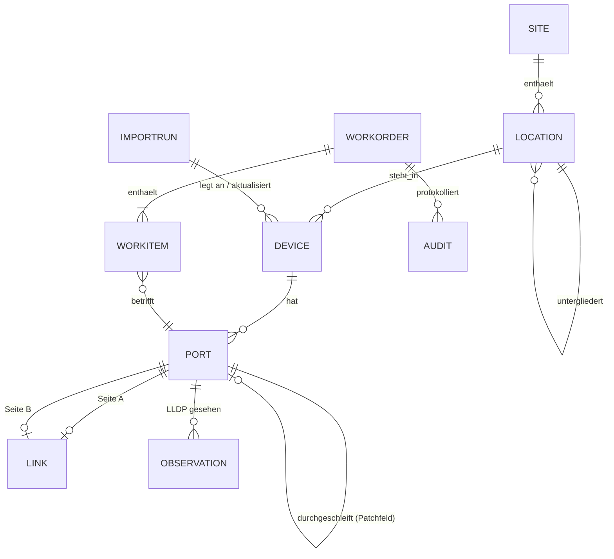

# Portwerk – Konzept

Stand: Konzeptphase (Entwurf zur Abstimmung, noch kein Code).

**Ziel:** Verwaltung und Planung von **Verkabelung/Patchungen** (Switchport ↔ Patchfeld ↔ Dose ↔ Endgerät) als schlankes Web-Werkzeug.
Der Schwerpunkt liegt auf dem **Ablauf** (Patchauftrag planen → freigeben → ausführen → bestätigen, mit Historie) und nicht auf einer
umfassenden Rechenzentrums-Dokumentation. Eine feste **Schnittstelle zu [OpenPlan](https://github.com/bh2005/openplan)** verbindet
Patchaufträge mit der Projektplanung.

Abgrenzung: Das Betriebssystem-Patching von Servern ist *nicht* Thema (dafür gibt es AutoPatch).

## 1. Leitlinien

- **Schlank:** ein Container, FastAPI + SQLite, Vue 3 / TypeScript. Deutsche Oberfläche.
- **Gleiches Aussehen und gleiche Bedienung wie die anderen Web-Projekte** (chrony-webui, OpenPlan): Sidebar, Dark Mode, kontextbezogenes
  Hilfe-Panel (`F1` / `?`) mit Handbuch, Tooltips an Feldern, lokale Benutzer plus optional AD/LDAP, Rollen, Audit-Log.
- **Bestand ändert sich über Aufträge.** Direkte Änderungen am Bestand sind nur Administratoren erlaubt (und werden protokolliert).
- **Öffentlich entwickelt:** neutrale Beispieldaten, Eigenheiten einer Umgebung nur über Konfiguration.
- **Idempotent:** Importe und Schnittstellen dürfen beliebig oft laufen, ohne Duplikate zu erzeugen (Schlüssel `ext_id` bzw. Hostname).

## 2. Datenmodell (Entwurf)

Patchfelder, Wanddosen und Endgeräte sind einheitlich **Geräte mit Ports**. Eine **Verbindung** verbindet genau zwei Ports.
Ein Pfad (z. B. Switch → Patchfeld → Dose → PC) ist eine Kette von Verbindungen; „durchgeschleifte“ Ports (Vorder-/Rückseite eines Patchfelds)
werden dazu als Paar verknüpft.



| Entität | Wichtige Felder |
|---|---|
| **Site** (Standort) | Code, Name, Adresse |
| **Location** (Gebäude/Etage/Raum/Rack) | Typ, Name, übergeordnete Location, bei Racks: Höheneinheiten |
| **Device** (Gerät) | Hostname, Typ (`switch`, `router`, `firewall`, `ap`, `server`, `patchpanel`, `outlet`, `endpoint`, …), Hersteller, Modell, Seriennummer, Location, HE-Position, Status (`geplant`/`aktiv`/`außer Betrieb`), `source`, `ext_id`, `last_seen` |
| **Port** | Gerät, Name (z. B. `Gi1/0/12`), Index, Medium (`RJ45`, `SFP`, `LWL`, …), Geschwindigkeit, Beschreibung, Betriebs-/Adminstatus, `peer_port` (Durchschleifung), `ext_id` |
| **Link** (Verbindung) | Port A, Port B, Kabel (Typ, Länge, Farbe, Beschriftung), Status (`geplant`, `aktiv`, `zu trennen`, `getrennt`), `valid_from`, `valid_to` (damit bleibt die **Historie** erhalten), erzeugt durch Auftrag |
| **WorkOrder** (Patchauftrag) | Nummer (`PA-0001`), Titel, Beschreibung, Status, Priorität, Antragsteller, Freigeber, Ausführender, Termin (von/bis), Standort, **OpenPlan-Verknüpfung** (Projekt, Vorgang, Link) |
| **WorkItem** (Position) | Auftrag, Aktion (`herstellen` / `trennen` / `umstecken`), Port A, Port B (bei `umstecken`: alter und neuer Port), Kabel, Bemerkung, Status (`offen` / `erledigt` / `Abweichung`), ausgeführt von/am |
| **Observation** (LLDP-Beobachtung) | lokaler Port, gesehener Nachbar (Hostname/Portname), Zeitpunkt, Quelle |
| **ImportRun** | Quelle, Zeitpunkt, Zähler (neu/geändert/unverändert/Fehler), Protokoll |
| **User / Role / Audit / ApiToken / Webhook** | wie in OpenPlan |

Regeln: ein Port hat höchstens **eine aktive Verbindung**; Aufträge prüfen Konflikte (Port belegt, doppelt verwendet, Terminüberschneidung).

## 3. Ablauf eines Patchauftrags

```
Entwurf ──einreichen──► Geplant ──freigeben──► Freigegeben ──starten──► In Ausführung
                          │ Konfliktprüfung                                   │ Positionen abhaken
                          ▼                                                   ▼
                      Abgelehnt                                  Ausgeführt ──bestätigen──► Bestätigt
                                                                    │ Soll/Ist-Abweichung            (Bestand wird fortgeschrieben,
                                                                    ▼                                 Historie)
                                                              Nacharbeit
```

- **Planen:** Positionen erfassen, *freie Ports finden*, Konfliktprüfung (Port belegt, Gerät außer Betrieb, Doppelbelegung in anderen Aufträgen).
- **Freigeben:** Rolle Freigeber (Vier-Augen-Prinzip optional). Danach entsteht die **Arbeitsanweisung** (druckbar/PDF/CSV: Port A → Port B, Kabel, Beschriftung).
- **Ausführen:** Techniker hakt Positionen ab, erfasst Abweichungen mit Notiz.
- **Bestätigen:** durch Antragsteller und/oder per **Soll/Ist-Abgleich** (LLDP). Erst dann wird der Bestand fortgeschrieben; alte Verbindungen erhalten `valid_to`.
- Jeder Schritt landet im Audit-Log (wer, wann, was; Statuswechsel mit Notiz).

## 4. Soll/Ist-Abgleich (Alleinstellungsmerkmal)

LLDP-Nachbarn eines Switchports zeigen, was *tatsächlich* an der Gegenstelle hängt. Der Abgleich vergleicht pro dokumentierter Verbindung:

| Ergebnis | Bedeutung |
|---|---|
| `ok` | Nachbar/Port entspricht der Dokumentation |
| `abweichend` | Nachbar sieht anders aus als dokumentiert (Vertauscht? Falscher Port?) |
| `unbekannt` | keine LLDP-Daten (z. B. Endgeräte ohne LLDP, Patchfelder – dort wird die Kette bis zum ersten aktiven Gerät verfolgt) |

Nach einem Auftrag kann der Abgleich automatisch laufen und das Ergebnis als Bestätigungsvorschlag anzeigen. Außerdem eine Übersicht
„Bestand weicht von der Realität ab“ als Bericht.

*Offen:* Aus welcher Quelle kommen die LLDP-Nachbarn (Checkmk-Inventar-Pfad bzw. gesonderte Auswertung)? Das wird zu Beginn gegen die
Zielumgebung geprüft.

## 5. Import

Quellen: **Checkmk**, **JSON**, **CSV** und **API**. Alle Wege laufen über dieselbe Importlogik (Trockenlauf, Vorschau, Protokoll, idempotent).

| Quelle | Inhalt |
|---|---|
| **Checkmk** (REST-API und Inventar) | Hosts (Hostname, Standort/Labels/Ordner, Typ), Interfaces aus dem HW/SW-Inventar (Name, Beschreibung, Geschwindigkeit, Status), optional LLDP-Nachbarn |
| **CSV** | Spaltenzuordnung per Assistent (wie die Geräteliste in OpenPlan), Vorschau, Trockenlauf, „alles oder nichts“ pro Lauf |
| **JSON** | feste, dokumentierte Struktur (Geräte mit Ports), gleiche Prüfungen wie CSV |
| **API** | `POST /api/import/devices` und `/api/import/links` (Stapel, `ext_id` als Schlüssel), mit API-Token |

Regeln: Import ändert nur Stammdaten (Geräte, Ports), **keine bestehenden Verbindungen** – diese ändern nur Aufträge. Geräte, die in der Quelle
nicht mehr vorkommen, werden markiert (`last_seen`), nicht gelöscht.

## 6. Schnittstelle zu OpenPlan

OpenPlan bietet bereits API-Zugänge (Token `op_…`), **externe Referenzen je Vorgang**, Rückmeldungen (`POST /api/tasks/{id}/events`) und
signierte **Webhooks**. Portwerk nutzt genau diese Mittel – dasselbe Muster wie die AutoPatch-Anbindung.

**Richtung 1 – Portwerk → OpenPlan**
1. Pro Patchauftrag wird der zugehörige Vorgang gesucht: Gerät per Hostname (`GET /api/projects/{pid}/lookup?hostname=…`), darunter der Schritt,
   dessen Name zu `patch|verkabel|umstecken` passt (überschreibbar je Auftrag).
2. Am Vorgang wird die Referenz gesetzt: System `portwerk`, Wert `PA-0042`, Link zum Auftrag.
3. Statuswechsel werden zurückgemeldet:

   | Auftrag | OpenPlan-Vorgang |
   |---|---|
   | Freigegeben / In Ausführung | in Arbeit |
   | Bestätigt | erledigt (Notiz: Auftrag, Soll/Ist-Ergebnis) |
   | Abweichung / Nacharbeit | blockiert (Notiz mit Grund) |
   | Abgebrochen/Abgelehnt | unverändert + Notiz |

**Richtung 2 – OpenPlan → Portwerk (Webhooks)**
`task.status`, `task.assigned`, `task.blocked` für Vorgänge mit Referenz `portwerk`: Terminänderung, Verantwortlicher und Blockade
erscheinen am Auftrag (Signatur `X-OpenPlan-Signature` wird geprüft, Wiederholungen abgewehrt).

**Richtung 3 (später) – Geräte aus OpenPlan**
Neue Geräte aus Geräte-Rollouts (Hostname, Standort, Typ) als Importquelle `openplan`, damit ein neu geplanter Switch ohne Doppelerfassung
im Patchbestand erscheint.

**Einrichtung:** in OpenPlan ein API-Zugang (Umfang `write`) und das Dienstkonto als Projektmitglied; in Portwerk Adresse, Token,
Standardprojekt und Schrittnamen eintragen, „Verbindung testen“. Ein Fehler bei der Rückmeldung blockiert nie einen Auftrag; das Ergebnis der
letzten Meldung steht in den Einstellungen.

*Änderung in OpenPlan (klein):* das System `portwerk` muss in der Liste der erlaubten Referenzsysteme stehen
(bisher `servicenow`, `awx`, `checkmk`, `jira`).

## 7. Rollen

| Rolle | Rechte |
|---|---|
| `admin` | alles, Verwaltung, Importe, Direktänderungen am Bestand |
| `planer` | Aufträge anlegen und einreichen |
| `freigeber` | Aufträge freigeben/ablehnen |
| `techniker` | Aufträge ausführen, Positionen abhaken |
| `viewer` | nur lesen |

Rollen sind kombinierbar; lokale Benutzer plus optional AD/LDAP (Gruppen → Rollen) wie in den anderen Projekten.

## 8. Technik

- Backend: FastAPI (Python 3.12), SQLite (Migrationen als SQL-Dateien), Tests mit pytest.
- Frontend: Vue 3, TypeScript, Vite, Tailwind (gleiche Farbpalette/Komponenten wie chrony-webui und OpenPlan), PWA.
- Betrieb: ein Docker-Container (Port 8084), Backup/Restore, Audit-Log, Swagger unter `/docs`.
- CI: GitHub Actions (Backend-Tests, Frontend-Typprüfung/-Build).

## 9. Umfang in Etappen

| Etappe | Inhalt |
|---|---|
| **1 – Stammdaten und Import** | Standorte/Locations/Racks, Geräte, Ports, Import aus Checkmk, CSV, JSON, API; Port-Ansicht und freie Ports; Benutzer/Rollen, Audit, Hilfe |
| **2 – Patchverbindungen und Aufträge** | Verbindungen, Pfadansicht, Aufträge mit Ablauf und Historie, Konfliktprüfung, Arbeitsanweisung (Druck/CSV/PDF), **OpenPlan-Schnittstelle** |
| **3 – Soll/Ist** | LLDP-Beobachtungen, Abgleich, Bestätigungsvorschlag, Abweichungsbericht |
| **4 – Ausbau** | Webhooks nach außen, Berichte, Geräte aus OpenPlan, Beschriftungsetiketten |

## 10. Offene Punkte zur Abstimmung

1. Kabel als **eigene Entität** (Kabelnummer, Bestand) oder nur als Attribute der Verbindung (Vorschlag: zunächst Attribute)?
2. Genaues Verhalten „durchgeschleift“ bei Patchfeldern (Vorder-/Rückseite) und Dosen – Beispiele aus der Praxis sammeln.
3. Quelle der LLDP-Daten (siehe Abschnitt 4).
4. Standardnamen der OpenPlan-Schritte (Vorschlag: `Patchen`).
5. Vier-Augen-Prinzip: immer, optional je Auftrag, oder nur ab Priorität?
